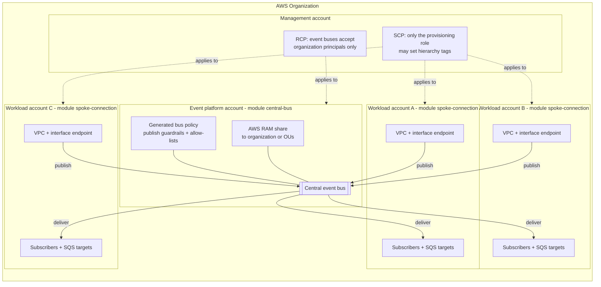
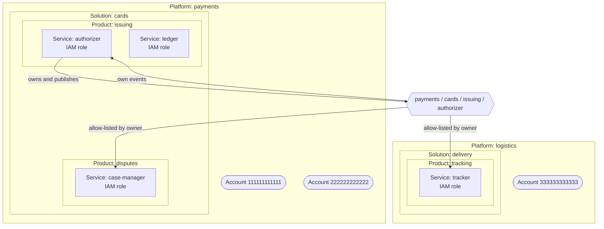
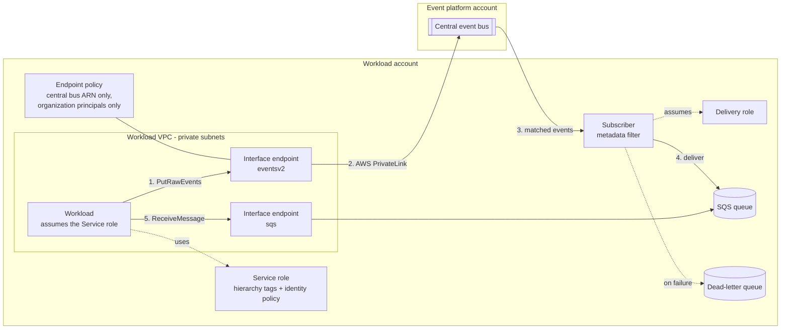
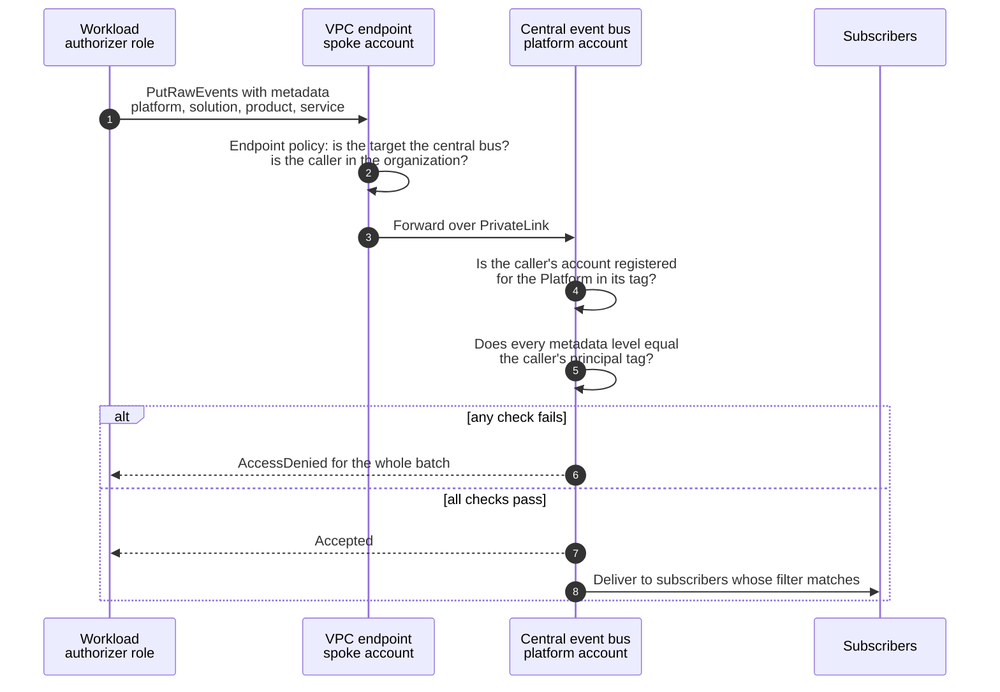
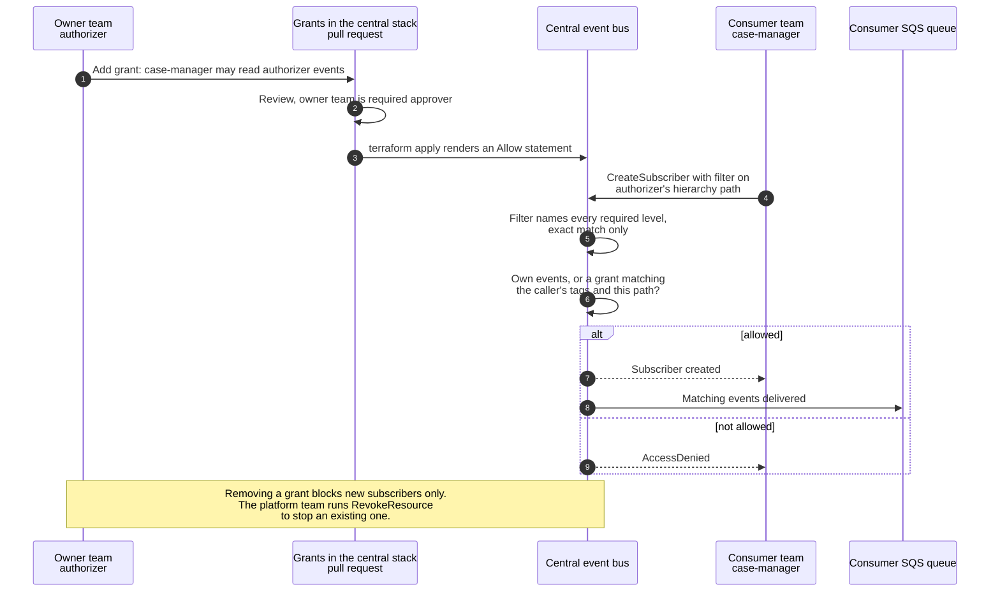
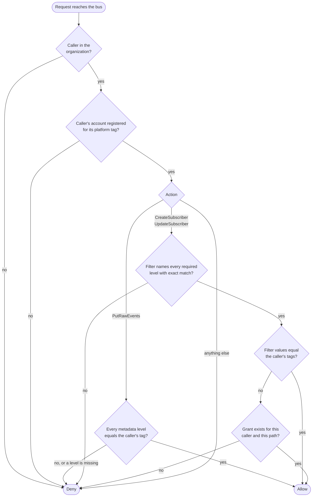

# terraform-aws-org-event-bus

Organization-wide Amazon EventBridge for AWS Organizations: one central event bus owned by a
platform team, private connectivity from every workload VPC, and attribute-based access control
(ABAC) that follows a configurable business hierarchy such as
**Platform → Solution → Product → Service**.

> **Status: design.** This README is the design document. No Terraform code exists yet, nothing
> has been deployed, and the items in [Assumptions to prove](#assumptions-to-prove) are untested.
> The research behind the design is in
> [docs/research-eventbridge-org-level.md](docs/research-eventbridge-org-level.md).

## Contents

- [What this repository provides](#what-this-repository-provides)
- [Design decisions](#design-decisions)
- [Level 1: the organization](#level-1-the-organization)
- [Level 2: the ownership hierarchy](#level-2-the-ownership-hierarchy)
- [Level 3: a spoke account and its VPC](#level-3-a-spoke-account-and-its-vpc)
- [Level 4: one event, end to end](#level-4-one-event-end-to-end)
- [Access model](#access-model)
- [Module `central-bus`](#module-central-bus)
- [Module `spoke-connection`](#module-spoke-connection)
- [Organization guardrails](#organization-guardrails)
- [Limits and costs](#limits-and-costs)
- [Assumptions to prove](#assumptions-to-prove)
- [Fallback: Custom Event Bus - Classic](#fallback-custom-event-bus---classic)
- [Repository layout](#repository-layout)

## What this repository provides

Two Terraform modules, deployed by two different teams:

| Module | Deployed by | Deployed in | Purpose |
|---|---|---|---|
| [`modules/central-bus`](#module-central-bus) | Platform team | One event platform account, once per Region | The shared event bus, its organization share, and the generated access policy |
| [`modules/spoke-connection`](#module-spoke-connection) | Each workload team | Each workload account, once per VPC | Private endpoint to the bus, the workload's tagged IAM role, and its subscriptions |

The rules the two modules enforce together:

1. A workload is a **Service**. Its IAM role carries one tag per hierarchy level.
2. A Service can **publish** only events stamped with its own hierarchy path.
3. A Service can **subscribe** to the events it owns.
4. An owner can **allow-list** other Services to subscribe to its events.
5. The hierarchy itself (level names and depth) is a variable of the central module.

## Design decisions

| Decision | Choice | Why |
|---|---|---|
| Bus type | The EventBridge **Custom Event Bus** launched in September 2026 (`event-busv2`), not Custom Event Bus - Classic | It is the only EventBridge bus whose IAM model exposes publisher-supplied attributes (`events:Metadata/<key>`) on both publish and subscribe. Classic exposes only `source` and `detail-type`. |
| Topology | One bus per Region, shared to the organization with AWS RAM | Matches current AWS guidance. Classic bus-to-bus forwarding is one hop only and caps at 300 rules per bus. |
| Who owns consumption | Each spoke owns its subscribers, targets and delivery roles | The new bus requires the target to be in the subscriber owner's account, which fits a spoke module. |
| Hierarchy encoding | One event metadata key and one IAM principal tag per level, same names | The policy compares the two directly, so the hierarchy is data, not code. |
| Allow-lists | Declared as reviewed data in the central stack, rendered as explicit policy statements | An allow-list is an entitlement, not an attribute match. Tags on the consumer cannot say which producers it may read. |
| Endpoints | One interface endpoint per spoke VPC | Lets each spoke carry its own least-privilege endpoint policy. |
| Terraform resources for the bus | CloudFormation-backed resources, isolated behind the module interface | `hashicorp/aws` had no resource for the new bus as of 6.73.0. |

The choice of the new bus is the largest bet in this design. It depends on behaviour AWS documents
but does not demonstrate; see [Assumptions to prove](#assumptions-to-prove) and the
[Classic fallback](#fallback-custom-event-bus---classic).

## Level 1: the organization

The platform account owns the bus. AWS RAM shares it with the organization (or selected OUs).
Every workload account reaches it through its own VPC endpoint and consumes through its own
subscribers. Guardrails at organization level make the hierarchy tags trustworthy.



The bus and everything that publishes to it or subscribes to it must be in the same Region. A
multi-Region estate deploys `central-bus` once per Region.

## Level 2: the ownership hierarchy

The hierarchy is a list of level names passed to `central-bus`. The default is
`["platform", "solution", "product", "service"]`. An AWS account is owned by exactly one
top-level unit (a Platform). A workload role is one leaf (a Service) and is identified by its
full path.



The same vocabulary appears in three places, and the module keeps them aligned:

| Plane | Carrier | Example |
|---|---|---|
| Identity | IAM role tags, read as `aws:PrincipalTag/<level>` | `platform=payments`, `solution=cards`, `product=issuing`, `service=authorizer` |
| Event | Metadata keys set by the publisher on `PutRawEvents`, read as `events:Metadata/<level>` | same four keys and values |
| Account | `aws:PrincipalAccount`, checked against the accounts registered for the Platform | `111111111111` belongs to `payments` |

The account check exists because it is the one attribute a team cannot forge: a role in a
`logistics` account that somehow carries `platform=payments` is still denied.

## Level 3: a spoke account and its VPC

The workload has no internet access. It publishes through an EventBridge interface endpoint in
its own VPC. Delivery never enters the VPC: EventBridge writes to a queue in the spoke account
over the AWS network, and the workload reads the queue through the SQS endpoint.



Three independent gates must all allow a publish: the role's identity policy, the endpoint
policy, and the bus policy.

## Level 4: one event, end to end

### Publishing



### Subscribing

Access is decided when a subscriber is created or its filter is updated, not per delivered
event. The filter is the request; the policy decides whether that filter is allowed.



### How the bus policy decides



## Access model

### Event shape

Publishers call `PutRawEvents`, because metadata exists only on that API. The hierarchy goes in
metadata; the business payload goes in the data.

```json
{
  "Metadata": {
    "platform": "payments",
    "solution": "cards",
    "product": "issuing",
    "service": "authorizer",
    "event-type": "CardAuthorized",
    "event-version": "1"
  },
  "Data": {
    "authorizationId": "a-7f3c",
    "amount": 4250,
    "currency": "CHF"
  }
}
```

The exact request syntax of `PutRawEvents` is not reproduced here; the block shows the logical
content. `event-type` and `event-version` are conventions of this design, not access attributes.

### Policy statements the central module generates

All statements below are **illustrative and untested**. They show the intended shape.

**Publish only what you own.** One Deny per level, because conditions inside one statement are
combined with AND and a mismatch on any single level must deny. Negated operators also match a
missing value, so an event without the key, or a role without the tag, is denied.

```json
{
  "Sid": "PublishOwnServiceLevel",
  "Effect": "Deny",
  "Principal": "*",
  "Action": "events:PutRawEvents",
  "Resource": "arn:aws:events:eu-central-1:999999999999:event-busv2/org",
  "Condition": {
    "StringNotEquals": {
      "events:Metadata/service": "${aws:PrincipalTag/service}"
    }
  }
}
```

**A Platform's tag is only valid in that Platform's accounts.** One statement per Platform.

```json
{
  "Sid": "PaymentsAccountsOnly",
  "Effect": "Deny",
  "Principal": "*",
  "Action": "events:*",
  "Resource": "*",
  "Condition": {
    "StringEquals": { "aws:PrincipalTag/platform": "payments" },
    "StringNotEquals": { "aws:PrincipalAccount": ["111111111111", "222222222222"] }
  }
}
```

**Subscribe to your own events.** Constant size, whatever the number of services. The `Null`
check closes a documented bypass: without it, a filter that omits a key passes
`ForAllValues`.

```json
{
  "Sid": "SubscribeOwnEvents",
  "Effect": "Allow",
  "Principal": "*",
  "Action": ["events:CreateSubscriber", "events:UpdateSubscriber"],
  "Resource": "arn:aws:events:eu-central-1:999999999999:event-busv2/org",
  "Condition": {
    "StringEquals": {
      "aws:PrincipalOrgID": "o-exampleorgid",
      "events:Metadata/platform/Matcher": "exact",
      "events:Metadata/solution/Matcher": "exact",
      "events:Metadata/product/Matcher": "exact",
      "events:Metadata/service/Matcher": "exact"
    },
    "Null": {
      "events:Metadata/platform": "false",
      "events:Metadata/solution": "false",
      "events:Metadata/product": "false",
      "events:Metadata/service": "false"
    },
    "ForAllValues:StringEquals": {
      "events:Metadata/platform": "${aws:PrincipalTag/platform}",
      "events:Metadata/solution": "${aws:PrincipalTag/solution}",
      "events:Metadata/product": "${aws:PrincipalTag/product}",
      "events:Metadata/service": "${aws:PrincipalTag/service}"
    }
  }
}
```

**Allow-list.** One statement per grant, with literal values on both sides: the owner's path in
the filter conditions, the consumer's path in the principal-tag conditions.

```json
{
  "Sid": "GrantAuthorizerToCaseManager",
  "Effect": "Allow",
  "Principal": "*",
  "Action": ["events:CreateSubscriber", "events:UpdateSubscriber"],
  "Resource": "arn:aws:events:eu-central-1:999999999999:event-busv2/org",
  "Condition": {
    "StringEquals": {
      "aws:PrincipalOrgID": "o-exampleorgid",
      "aws:PrincipalTag/platform": "payments",
      "aws:PrincipalTag/solution": "cards",
      "aws:PrincipalTag/product": "disputes",
      "aws:PrincipalTag/service": "case-manager",
      "events:Metadata/platform/Matcher": "exact",
      "events:Metadata/solution/Matcher": "exact",
      "events:Metadata/product/Matcher": "exact",
      "events:Metadata/service/Matcher": "exact"
    },
    "Null": {
      "events:Metadata/platform": "false",
      "events:Metadata/solution": "false",
      "events:Metadata/product": "false",
      "events:Metadata/service": "false"
    },
    "ForAllValues:StringEquals": {
      "events:Metadata/platform": "payments",
      "events:Metadata/solution": "cards",
      "events:Metadata/product": "issuing",
      "events:Metadata/service": "authorizer"
    }
  }
}
```

### Properties worth knowing

- **Subscribe rights are not granted through RAM.** RAM managed permissions carry no
  conditions, so a RAM `SubscribeOnly` grant would let any account subscribe to anything. RAM
  grants publish; the bus policy grants subscribe. Allow-lists are closed by default.
- **Subscribe checks run at create and update only.** Tightening the policy or removing a grant
  does not stop an existing subscriber. The bus owner stops one with `RevokeResource`.
- **Wider scopes are a filter with fewer keys.** Metadata filters are exact match only. A grant
  on a whole Product is a grant whose required keys stop at `product`. `read_scope` on a grant
  and `own_read_scope` on the bus control which levels are required.
- **A batch is all or nothing.** One entry with wrong metadata denies the whole `PutRawEvents`
  call.

## Module `central-bus`

Deployed once per Region in the event platform account. Not the management account: resource
control policies do not apply there.

**Creates**

- The event bus, with retention and optional customer managed KMS key.
- An AWS RAM share to the organization or to selected OUs, publish only.
- The bus policy, generated from the hierarchy, the Platform account registry and the grants.
- Alarms on delivered events and egress bytes per subscriber account.

**Inputs (planned)**

| Name | Type | Description |
|---|---|---|
| `name` | `string` | Bus name. |
| `organization_id` | `string` | Used in every Allow statement. |
| `share_with` | `list(string)` | Organization or OU ARNs for the RAM share. |
| `hierarchy` | `list(string)` | Level names, top to bottom. Default `["platform", "solution", "product", "service"]`. Drives metadata keys, tag keys and generated conditions. |
| `tag_key_prefix` | `string` | Optional prefix for the IAM tag keys. Default `""`. |
| `platforms` | `map(object({ account_ids = list(string) }))` | Which accounts each top-level unit owns. |
| `own_read_scope` | `string` | Level down to which a service may read without a grant. Default: the last level (its own events only). |
| `grants` | `list(object)` | Allow-list entries: `owner` path, `consumer` path, optional `read_scope`. |
| `retention_days` | `number` | Event retention. Default `7`. |
| `kms_key_arn` | `string` | Optional customer managed key. |

**Outputs (planned):** `bus_arn`, `bus_name`, `hierarchy`, `tag_keys`, `ram_share_arn`.

**Example**

```hcl
module "central_bus" {
  source = "github.com/aws-abaschen/terraform-aws-org-event-bus//modules/central-bus"

  name            = "org"
  organization_id = "o-exampleorgid"
  share_with      = ["arn:aws:organizations::123456789012:organization/o-exampleorgid"]

  hierarchy = ["platform", "solution", "product", "service"]

  platforms = {
    payments  = { account_ids = ["111111111111", "222222222222"] }
    logistics = { account_ids = ["333333333333"] }
  }

  grants = [
    {
      owner    = { platform = "payments", solution = "cards", product = "issuing", service = "authorizer" }
      consumer = { platform = "payments", solution = "cards", product = "disputes", service = "case-manager" }
    },
    {
      owner    = { platform = "payments", solution = "cards", product = "issuing", service = "authorizer" }
      consumer = { platform = "logistics", solution = "delivery", product = "tracking", service = "tracker" }
    },
  ]
}
```

**How owners allow-list consumers.** Grants live as files in the central stack (for example one
YAML file per owner service under `grants/`). A `CODEOWNERS` entry makes the owning team the
required reviewer of its own file. The pull request is the approval workflow; EventBridge has
none of its own.

## Module `spoke-connection`

Deployed in each workload account, once per VPC.

**Creates**

- The EventBridge interface endpoint (`eventsv2`) with private DNS, its security group, and an
  endpoint policy limited to the central bus and to organization principals.
- Optionally the SQS interface endpoint.
- One IAM role per declared service, tagged with its hierarchy path, with an identity policy
  allowing publish to the central bus.
- For each subscription: a subscriber with a metadata filter, an SQS queue, a dead-letter
  queue and a delivery role, all in the spoke account.

**Inputs (planned)**

| Name | Type | Description |
|---|---|---|
| `bus_arn` | `string` | Output of `central-bus`. |
| `organization_id` | `string` | Used in the endpoint policy. |
| `hierarchy` | `list(string)` | Must equal the central module's value. |
| `vpc_id`, `subnet_ids` | `string`, `list(string)` | Where the endpoints go. |
| `create_sqs_endpoint` | `bool` | Default `true`. |
| `services` | `map(object)` | Per service: hierarchy `path`, role trust policy, `publish` flag, `subscriptions`. |

Each subscription names the `owner` path it wants to read. Subscribing to another service's
events succeeds only if the owner has added a matching grant in the central stack.

**Outputs (planned):** `endpoint_id`, `role_arns`, `queue_arns`, `subscriber_arns`.

**Example**

```hcl
module "event_bus_connection" {
  source = "github.com/aws-abaschen/terraform-aws-org-event-bus//modules/spoke-connection"

  bus_arn         = "arn:aws:events:eu-central-1:999999999999:event-busv2/org"
  organization_id = "o-exampleorgid"
  hierarchy       = ["platform", "solution", "product", "service"]

  vpc_id     = "vpc-0abc"
  subnet_ids = ["subnet-0a", "subnet-0b"]

  services = {
    case-manager = {
      path    = { platform = "payments", solution = "cards", product = "disputes", service = "case-manager" }
      publish = true
      subscriptions = {
        own = {
          owner = { platform = "payments", solution = "cards", product = "disputes", service = "case-manager" }
        }
        authorizations = {
          owner = { platform = "payments", solution = "cards", product = "issuing", service = "authorizer" }
        }
      }
    }
  }
}
```

## Organization guardrails

ABAC on a shared bus is only as sound as the tags. These controls are prerequisites and sit
outside both modules, in the organization's guardrail stack. An example will be provided under
`examples/guardrails`.

| Control | Type | Effect |
|---|---|---|
| Protect hierarchy tag keys | SCP | Denies `iam:TagRole`, `iam:UntagRole` and `sts:TagSession` on the hierarchy keys for every principal except the provisioning role that applies `spoke-connection`. |
| Organization principals only | RCP | Event buses reject callers outside the organization. Does not cover the management account or service-linked roles. |
| Allowed tag values | Tag policy | Standardizes spelling and values. Hygiene only; it does not evaluate untagged resources. |

Organizations account tags are not visible to IAM, which is why the hierarchy is copied onto
roles and the account-to-Platform mapping is passed to `central-bus` explicitly.

## Limits and costs

Figures from the research report; confirm against the live AWS pages before relying on them.

| Item | Value |
|---|---|
| Bus policy size | 20,480 bytes, adjustable. Roughly 40 to 55 grant statements at this design's statement size. |
| Subscribers per bus | 10,000 by default. |
| Buses of this type per account | 5 by default. |
| Throughput | 500,000 events per second per bus. |
| Event size | 1 MB. |
| Subscriber changes | One create or delete in progress per bus across all accounts. Parallel spoke applies must retry. |
| Regions | 14 at launch. Bus, publishers and subscribers must share a Region. |
| Pricing | Per GB: publishers pay ingress, subscribers pay egress. |
| Interface endpoint | Billed per endpoint, per Availability Zone, per hour, plus data. |

The policy size is the scaling limit of the allow-list. Past it, grants move out of the bus
policy into a control plane that creates subscribers on behalf of consumers. That is out of
scope for the first version.

## Assumptions to prove

A proof of concept must settle these before any module code is written, in this order.

| # | Assumption | If it fails |
|---|---|---|
| 1 | `events:Metadata/<key>` can be compared with `${aws:PrincipalTag/<key>}` on `PutRawEvents`, `CreateSubscriber` and `UpdateSubscriber`, in a bus policy, for callers in other accounts. AWS's policy language permits it; no AWS example shows it. | Fall back to literal per-service statements keyed on `aws:PrincipalAccount`, or a publish API that stamps metadata from the caller's identity. |
| 2 | The bus policy size fits the expected number of grants. | Bring the control plane forward. |
| 3 | The `eventsv2` interface endpoint supports endpoint policies. | Rely on identity and bus policies; treat the endpoint as a network path only. |
| 4 | The bus is available in the target Region. | Use the Classic fallback in that Region. |
| 5 | The CloudFormation-backed Terraform route works under the one-at-a-time subscriber quota. | Add serialization or retries in the spoke module. |
| 6 | The RAM publish permission does not also allow the classic `PutEvents` envelope, which carries no metadata. | Add an explicit Deny on `events:PutEvents` for workload principals. |

## Fallback: Custom Event Bus - Classic

If assumption 1 or 4 fails, the same two-module interface can be implemented on a Classic bus,
with weaker guarantees:

- The hierarchy collapses into one dotted `source` string, for example
  `payments.cards.issuing.authorizer`, enforced with a prefix condition on `events:source`.
- Consumption uses rules on the central bus with direct cross-account targets, so the platform
  account owns every rule (300 rules per bus, 5 targets per rule).
- The interface endpoint is `events` instead of `eventsv2`.
- Native `hashicorp/aws` resources cover everything.

## Repository layout

Planned. Only this README and the research report exist today.

```text
.
├── README.md
├── docs/
│   └── research-eventbridge-org-level.md
├── modules/
│   ├── central-bus/
│   └── spoke-connection/
└── examples/
    ├── complete/          # one platform account, two spokes
    ├── guardrails/        # SCP, RCP and tag policy
    └── proof-of-concept/  # the tests in "Assumptions to prove"
```
