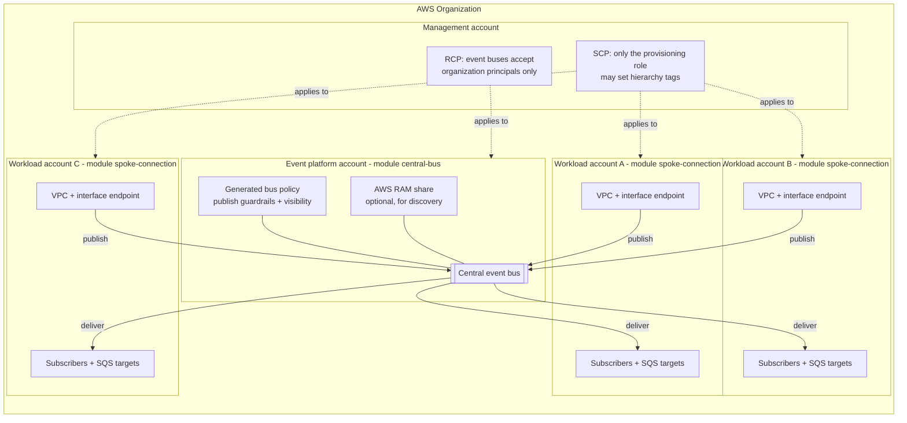
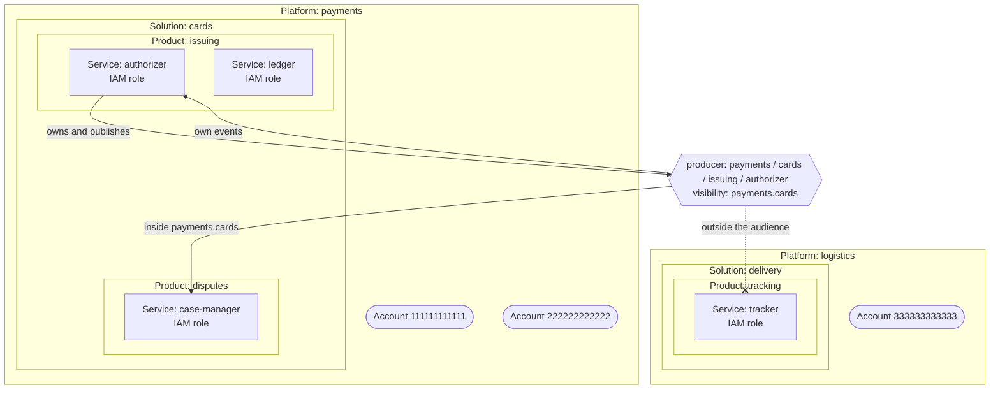
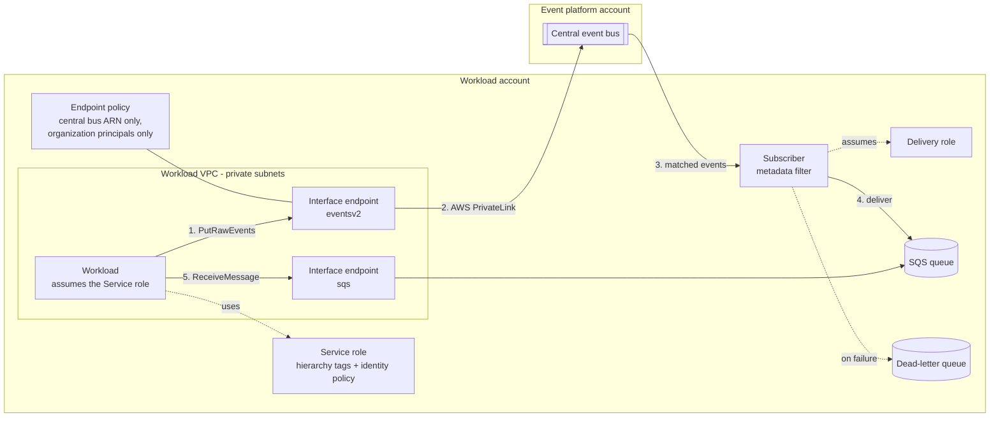
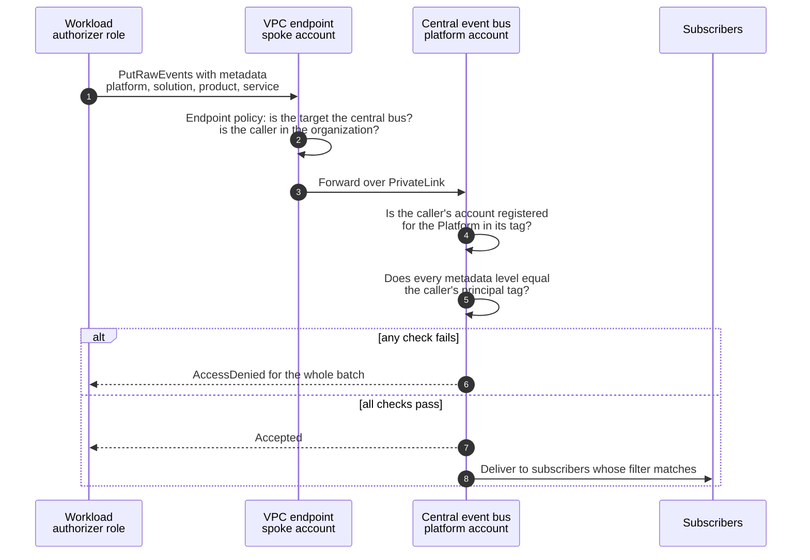
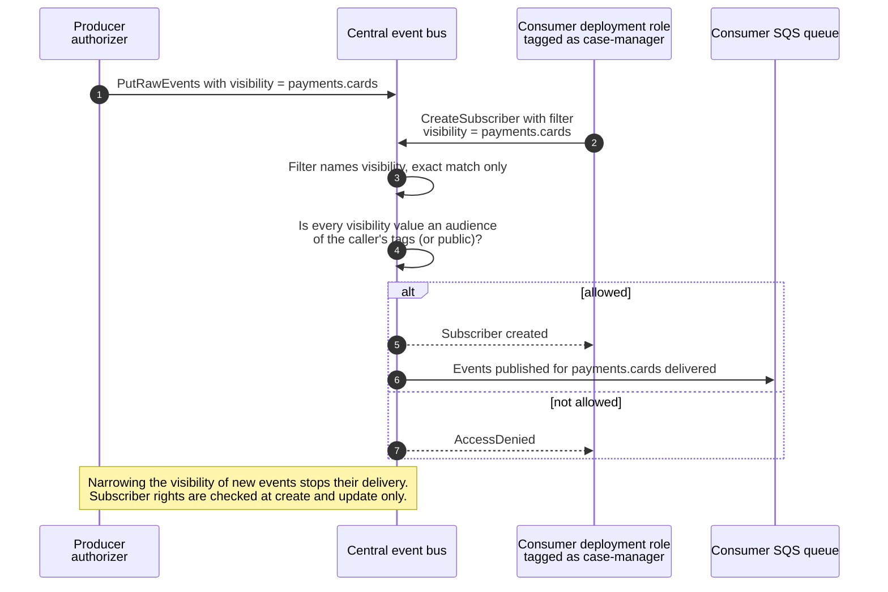
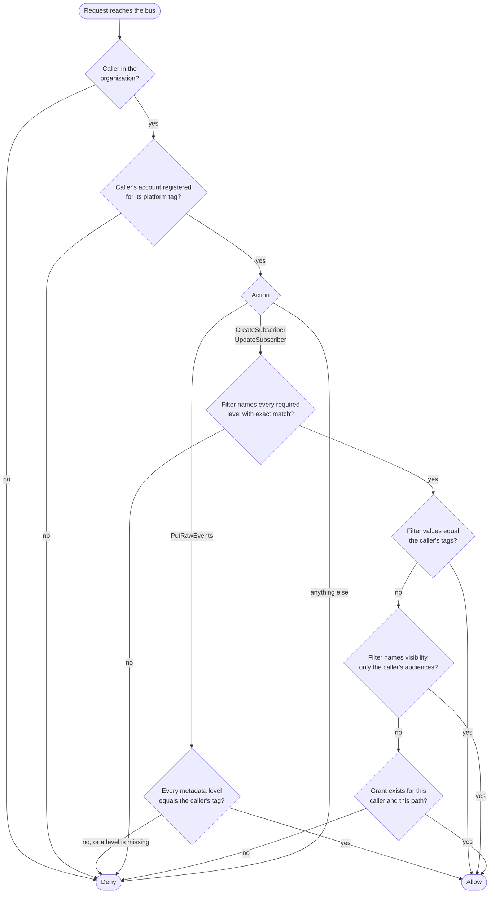

# terraform-aws-org-event-bus

Organization-wide Amazon EventBridge for AWS Organizations: one central event bus owned by a
platform team, private connectivity from every workload VPC, and attribute-based access control
(ABAC) that follows a configurable business hierarchy such as
**Platform → Solution → Product → Service**.

> **Status: implemented, not yet run against AWS.** The modules and the examples are written
> and pass `terraform validate` and offline `terraform test`. Nothing has been applied to an AWS
> account, so the items in [Assumptions to prove](#assumptions-to-prove) are still untested.
> Run the [proof of concept](examples/proof-of-concept) first. The research behind the design is
> in [docs/research-eventbridge-org-level.md](docs/research-eventbridge-org-level.md).

## Contents

- [What this repository provides](#what-this-repository-provides)
- [Design decisions](#design-decisions)
- [Level 1: the organization](#level-1-the-organization)
- [Level 2: the ownership hierarchy](#level-2-the-ownership-hierarchy)
- [Level 3: a spoke account and its VPC](#level-3-a-spoke-account-and-its-vpc)
- [Level 4: one event, end to end](#level-4-one-event-end-to-end)
- [Access model](#access-model)
- [Module `central-bus`](#module-central-bus)
- [Module `account-platforms`](#module-account-platforms)
- [Module `spoke-connection`](#module-spoke-connection)
- [Organization guardrails](#organization-guardrails)
- [Deployment order](#deployment-order)
- [Testing](#testing)
- [Limits and costs](#limits-and-costs)
- [Assumptions to prove](#assumptions-to-prove)
- [Repository layout](#repository-layout)

## What this repository provides

Three Terraform modules, deployed by two different teams:

| Module | Deployed by | Deployed in | Purpose |
|---|---|---|---|
| [`modules/central-bus`](#module-central-bus) | Platform team | One event platform account, once per Region | The shared event bus, its organization share, and the generated access policy |
| [`modules/account-platforms`](#module-account-platforms) | Platform team | Inside the central stack, with a provider that can read AWS Organizations | Builds the Platform account registry from account tags |
| [`modules/spoke-connection`](#module-spoke-connection) | Each workload team | Each workload account, once per service | Private endpoint to the bus, the workload's tagged IAM role, and its subscriptions |

The rules the two modules enforce together:

1. A workload is a **Service**. Its IAM role carries one tag per hierarchy level.
2. A Service can **publish** only events stamped with its own hierarchy path.
3. A Service can **subscribe** to the events it owns.
4. A producer decides **who else may read** each event, by putting an audience namespace such
   as `payments.cards` in the event's `visibility` metadata. Any Service inside that namespace
   can subscribe, without any change to the central stack.
5. The hierarchy itself (level names and depth) is a variable of the central module.

Adding a Service, a producer or a subscription never changes the bus account. Adding an
account or a Platform changes only account tags, and the account vending pipeline re-applies
the central stack.

## Design decisions

| Decision | Choice | Why |
|---|---|---|
| Bus type | The EventBridge **Custom Event Bus** launched in September 2026 (`event-busv2`), not Custom Event Bus - Classic | It is the only EventBridge bus whose IAM model exposes publisher-supplied attributes (`events:Metadata/<key>`) on both publish and subscribe. Classic exposes only `source` and `detail-type`. |
| Topology | One bus per Region, opened to the organization by its policy, optionally listed through AWS RAM | Matches current AWS guidance. Classic bus-to-bus forwarding is one hop only and caps at 300 rules per bus. |
| Who owns consumption | Each spoke owns its subscribers, targets and delivery roles | The new bus requires the target to be in the subscriber owner's account, which fits a spoke module. |
| Hierarchy encoding | One event metadata key and one IAM principal tag per level, same names | The policy compares the two directly, so the hierarchy is data, not code. |
| Sharing | The producer sets a `visibility` audience namespace on each event; the bus policy lets a subscriber filter on audiences it belongs to | A subscribe request carries only the caller's tags and its filter, so the producer can consent only in the bus policy or in its events. Consent in the event needs no central change and keeps the policy constant in size. Tags on the consumer cannot express consent: the consumer controls them. |
| Allow-lists | Optional `grants` in the central stack, for exceptions only | An entitlement the producer cannot express in its events, reviewed centrally. |
| Endpoints | One interface endpoint per spoke VPC | Lets each spoke carry its own least-privilege endpoint policy. |
| Terraform resources for the bus | The `awscc` provider (`awscc_eventsv2_event_bus`, `awscc_eventsv2_resource_policy`, `awscc_eventsv2_subscriber`), isolated behind the module interface | `hashicorp/aws` had no resource for the new bus as of 6.73.0. |

The choice of the new bus is the largest bet in this design. It depends on behaviour AWS documents
but does not demonstrate; see [Assumptions to prove](#assumptions-to-prove).

## Level 1: the organization

The platform account owns the bus and opens it to the organization through the bus policy.
Every workload account reaches it through its own VPC endpoint and consumes through its own
subscribers. Guardrails at organization level make the hierarchy tags trustworthy.



The bus and everything that publishes to it or subscribes to it must be in the same Region. A
multi-Region estate deploys `central-bus` once per Region.

## Level 2: the ownership hierarchy

The hierarchy is a list of level names passed to `central-bus`. The default is
`["platform", "solution", "product", "service"]`. An AWS account is owned by exactly one
top-level unit (a Platform). A workload role is one leaf (a Service) and is identified by its
full path.



The same vocabulary appears in three places, and the module keeps them aligned:

| Plane | Carrier | Example |
|---|---|---|
| Identity | IAM role tags, read as `aws:PrincipalTag/<level>` | `platform=payments`, `solution=cards`, `product=issuing`, `service=authorizer` |
| Event, producer | Metadata keys set by the publisher on `PutRawEvents`, read as `events:Metadata/<level>` | same four keys and values |
| Event, audience | One `visibility` metadata key: a hierarchy path joined with `.`, cut at any level, or `public` | `visibility=payments.cards` |
| Account | `aws:PrincipalAccount`, checked against the accounts registered for the Platform | `111111111111` belongs to `payments` |

The account check exists because it is the one attribute a team cannot forge: a role in a
`logistics` account that somehow carries `platform=payments` is still denied.

## Level 3: a spoke account and its VPC

The workload has no internet access. It publishes through an EventBridge interface endpoint in
its own VPC. Delivery never enters the VPC: EventBridge writes to a queue in the spoke account
over the AWS network, and the workload reads the queue through the SQS endpoint.



Three independent gates must all allow a publish: the role's identity policy, the endpoint
policy, and the bus policy.

## Level 4: one event, end to end

### Publishing



### Subscribing

Access is decided when a subscriber is created or its filter is updated, not per delivered
event. The filter is the request; the policy decides whether that filter is allowed. The
caller is the consumer's deployment role (the principal Terraform runs as), so that role
carries the service's hierarchy tags.



### How the bus policy decides



## Access model

### Event shape

Publishers call `PutRawEvents`, because metadata exists only on that API. The hierarchy goes in
metadata; the business payload goes in the data.

```json
{
  "Metadata": {
    "platform": "payments",
    "solution": "cards",
    "product": "issuing",
    "service": "authorizer",
    "visibility": "payments.cards",
    "event-type": "CardAuthorized",
    "event-version": "1"
  },
  "Data": {
    "authorizationId": "a-7f3c",
    "amount": 4250,
    "currency": "CHF"
  }
}
```

The exact request syntax of `PutRawEvents` is not reproduced here; the block shows the logical
content. `event-type` and `event-version` are conventions of this design, not access attributes.

**Producer namespace.** The four hierarchy keys. The bus policy forces them to equal the
publisher's tags, so they say who produced the event, and a subscriber can filter on any prefix
of them.

**Visibility namespace.** The `visibility` key, set freely by the producer: the publish rules
do not constrain it. Its value names an audience, the hierarchy values joined with `.` and cut
at any level, or `public` for the whole organization:

| `visibility` | Who may subscribe |
|---|---|
| absent | The owner only (and `grants`) |
| `payments.cards.issuing.authorizer` | The authorizer service |
| `payments.cards.issuing` | Every service of the issuing product |
| `payments.cards` | Every service of the cards solution |
| `payments` | Every service of the payments platform |
| `logistics.delivery.tracking` | Every service of another platform's product: targeted sharing |
| `public` | Every principal of the organization |

An event has one visibility value. To reach two disjoint audiences, publish it twice or pick
their common parent. Filters are exact match, so a subscriber in `payments.cards.disputes`
lists every audience it wants (`payments`, `payments.cards`, `payments.cards.disputes`,
`public`): `visibility_audiences` of `spoke-connection` gives that list.

### Policy statements the central module generates

The statements below show the shape `central-bus` generates. They are **untested against
AWS**. Deny statements also carry an exemption for `exempt_principal_arns` when that is set.

**Publish only what you own.** One Deny per level, because conditions inside one statement are
combined with AND and a mismatch on any single level must deny. Negated operators also match a
missing value, so an event without the key, or a role without the tag, is denied.

```json
{
  "Sid": "PublishOwnServiceLevel",
  "Effect": "Deny",
  "Principal": "*",
  "Action": "events:PutRawEvents",
  "Resource": "arn:aws:events:eu-central-1:999999999999:event-busv2/org",
  "Condition": {
    "StringNotEquals": {
      "events:Metadata/service": "${aws:PrincipalTag/service}"
    }
  }
}
```

**A Platform's tag is only valid in that Platform's accounts.** One statement per Platform.

```json
{
  "Sid": "PaymentsAccountsOnly",
  "Effect": "Deny",
  "Principal": "*",
  "Action": ["events:PutEvents", "events:PutRawEvents", "events:CreateSubscriber", "events:UpdateSubscriber"],
  "Resource": "arn:aws:events:eu-central-1:999999999999:event-busv2/org",
  "Condition": {
    "StringEquals": { "aws:PrincipalTag/platform": "payments" },
    "StringNotEquals": { "aws:PrincipalAccount": ["111111111111", "222222222222"] }
  }
}
```

A further Deny rejects any principal whose `platform` tag is missing or names no registered
Platform.

**Subscribe to your own events.** Constant size, whatever the number of services. The `Null`
check closes a documented bypass: without it, a filter that omits a key passes
`ForAllValues`.

```json
{
  "Sid": "SubscribeOwnEvents",
  "Effect": "Allow",
  "Principal": "*",
  "Action": ["events:CreateSubscriber", "events:UpdateSubscriber"],
  "Resource": "arn:aws:events:eu-central-1:999999999999:event-busv2/org",
  "Condition": {
    "StringEquals": {
      "aws:PrincipalOrgID": "o-exampleorgid",
      "events:Metadata/platform/Matcher": "exact",
      "events:Metadata/solution/Matcher": "exact",
      "events:Metadata/product/Matcher": "exact",
      "events:Metadata/service/Matcher": "exact"
    },
    "Null": {
      "events:Metadata/platform": "false",
      "events:Metadata/solution": "false",
      "events:Metadata/product": "false",
      "events:Metadata/service": "false"
    },
    "ForAllValues:StringEquals": {
      "events:Metadata/platform": "${aws:PrincipalTag/platform}",
      "events:Metadata/solution": "${aws:PrincipalTag/solution}",
      "events:Metadata/product": "${aws:PrincipalTag/product}",
      "events:Metadata/service": "${aws:PrincipalTag/service}"
    }
  }
}
```

**Subscribe to events made visible to you.** One statement, constant size. Every value the
filter lists for `visibility` must be one of the caller's audiences: its tags joined at each
depth, or `public`. Producer keys in the same filter are not constrained; they only narrow what
is received.

```json
{
  "Sid": "SubscribeVisibleEvents",
  "Effect": "Allow",
  "Principal": "*",
  "Action": ["events:CreateSubscriber", "events:UpdateSubscriber"],
  "Resource": "arn:aws:events:eu-central-1:999999999999:event-busv2/org",
  "Condition": {
    "StringEquals": {
      "aws:PrincipalOrgID": "o-exampleorgid",
      "events:Metadata/visibility/Matcher": "exact"
    },
    "Null": { "events:Metadata/visibility": "false" },
    "ForAllValues:StringEquals": {
      "events:Metadata/visibility": [
        "${aws:PrincipalTag/platform}",
        "${aws:PrincipalTag/platform}.${aws:PrincipalTag/solution}",
        "${aws:PrincipalTag/platform}.${aws:PrincipalTag/solution}.${aws:PrincipalTag/product}",
        "${aws:PrincipalTag/platform}.${aws:PrincipalTag/solution}.${aws:PrincipalTag/product}.${aws:PrincipalTag/service}",
        "public"
      ]
    }
  }
}
```

Because audiences join tag values with `.`, a tag value containing `.` could spell another
unit's namespace (`solution = "cards.issuing"`). One Deny per level rejects subscribe calls from
such principals, `spoke-connection` rejects such paths, and `central-bus` rejects such Platform
names and a Platform named `public`.

**Allow-list (exceptions).** One statement per grant, with literal values on both sides: the
owner's path in the filter conditions, the consumer's path in the principal-tag conditions.

```json
{
  "Sid": "GrantAuthorizerToCaseManager",
  "Effect": "Allow",
  "Principal": "*",
  "Action": ["events:CreateSubscriber", "events:UpdateSubscriber"],
  "Resource": "arn:aws:events:eu-central-1:999999999999:event-busv2/org",
  "Condition": {
    "StringEquals": {
      "aws:PrincipalOrgID": "o-exampleorgid",
      "aws:PrincipalTag/platform": "payments",
      "aws:PrincipalTag/solution": "cards",
      "aws:PrincipalTag/product": "disputes",
      "aws:PrincipalTag/service": "case-manager",
      "events:Metadata/platform/Matcher": "exact",
      "events:Metadata/solution/Matcher": "exact",
      "events:Metadata/product/Matcher": "exact",
      "events:Metadata/service/Matcher": "exact"
    },
    "Null": {
      "events:Metadata/platform": "false",
      "events:Metadata/solution": "false",
      "events:Metadata/product": "false",
      "events:Metadata/service": "false"
    },
    "ForAllValues:StringEquals": {
      "events:Metadata/platform": "payments",
      "events:Metadata/solution": "cards",
      "events:Metadata/product": "issuing",
      "events:Metadata/service": "authorizer"
    }
  }
}
```

### Properties worth knowing

- **Subscribe rights are not granted through RAM.** RAM managed permissions carry no
  conditions, so a RAM `SubscribeOnly` grant would let any account subscribe to anything. The
  bus policy grants subscribe. Events without `visibility` are private to their owner.
- **`PutEvents` is denied by default.** That API carries no metadata, so it would bypass the
  hierarchy.
- **Subscribe checks run at create and update only.** Tightening the policy or removing a grant
  does not stop an existing subscriber. The bus owner stops one with `RevokeResource`. A
  producer that narrows the `visibility` of new events stops their delivery to subscribers
  outside the new audience, since those filter on the old value.
- **Wider scopes are a filter with fewer keys.** Metadata filters are exact match only. A grant
  on a whole Product is a grant whose `owner` stops at `product`. `own_read_scope` on the bus
  does the same for reading without a grant.
- **A batch is all or nothing.** One entry with wrong metadata denies the whole `PutRawEvents`
  call.

## Module `central-bus`

Deployed once per Region in the event platform account. Not the management account: resource
control policies do not apply there.

**Creates**

- The event bus, with retention and an optional customer managed KMS key.
- The bus policy, generated from the hierarchy, the Platform account registry, the visibility
  settings and the grants. Its size grows with accounts and grants only, not with services or
  subscriptions.
  The plan fails if the policy exceeds the size quota.
- Optionally an AWS RAM share (publish only), which makes the bus discoverable in the
  accounts it is shared with. Access itself comes from the bus policy.

**Inputs**

| Name | Type | Default | Description |
|---|---|---|---|
| `name` | `string` | required | Bus name. |
| `organization_id` | `string` | required | Limits every Allow statement to the organization. |
| `platforms` | `map(object({ account_ids }))` | required | Top-level units and the accounts each one owns. Build it from account tags with [`account-platforms`](#module-account-platforms). |
| `hierarchy` | `list(string)` | `["platform", "solution", "product", "service"]` | Level names, top to bottom. Drives metadata keys, tag keys and conditions. |
| `tag_key_prefix` | `string` | `""` | Prefix for the IAM tag keys. Metadata keys are never prefixed. |
| `own_read_scope` | `string` | last level | Level down to which a principal may subscribe without a grant. |
| `visibility_key` | `string` | `"visibility"` | Metadata key of the audience namespace. Must not be a level name. |
| `visibility_separator` | `string` | `"."` | Joins levels into an audience. One character, not a letter, digit, `*`, `?` or `$`. |
| `visibility_public_value` | `string` | `"public"` | Audience for the whole organization. Null disables it. |
| `grants` | `list(object({ owner, consumer }))` | `[]` | Allow-list for exceptions. Both sides are a prefix of the hierarchy, so a grant can name one service or everything below a higher level. |
| `exempt_principal_arns` | `list(string)` | `[]` | Principals exempt from the Deny guardrails (platform operators, forwarders of AWS service events). |
| `allow_put_events` | `bool` | `false` | Allow the `PutEvents` envelope API, which carries no metadata. |
| `share_with` | `list(string)` | `[]` | Organization, OU or account principals for the optional RAM share. |
| `retention_days` | `number` | `7` | Event retention, 1 to 365. |
| `kms_key_arn` | `string` | `null` | Customer managed key. |
| `policy_size_limit` | `number` | `20480` | Policy size quota in bytes. |
| `tags` | `map(string)` | `{}` | Tags for the bus and the share. |

**Outputs:** `bus_arn`, `bus_name`, `hierarchy`, `tag_key_prefix`, `tag_keys`, `visibility`,
`policy_json`, `policy_bytes`, `ram_share_arn`.

**Example**

```hcl
module "central_bus" {
  source = "github.com/aws-abaschen/terraform-aws-org-event-bus//modules/central-bus"

  name            = "org"
  organization_id = "o-exampleorgid"

  hierarchy = ["platform", "solution", "product", "service"]

  platforms = {
    payments  = { account_ids = ["111111111111", "222222222222"] }
    logistics = { account_ids = ["333333333333"] }
  }

  # Optional: exceptions a producer cannot express with visibility.
  grants = []
}
```

**Grants are for exceptions.** Producers share through `visibility`. Keep `grants` for an
entitlement that must be reviewed centrally, as files in the central stack with the owning team
as required reviewer.

## Module `account-platforms`

Builds `platforms` for `central-bus` from a tag on each AWS account (AWS Organizations account
tags), so that no account list is maintained by hand. IAM has no condition key for account
tags, so the bus policy cannot read them directly: this module turns them into the account
list the policy checks (`Accounts<Platform>` and `DenyUnregistered<Platform>` statements).

Run it inside the central stack with a provider that can read AWS Organizations: the
management account, or a delegated administrator for Organizations. Tag each account when it is
vended (for example `platform = payments`), and make the last step of the account vending
pipeline re-apply the central stack. Adding an account, or a new top-level unit, then needs no
manual change to the bus stack. Adding producers or subscribers in an existing account needs
no change to the bus stack at all.

Only `ACTIVE` accounts are read. Accounts without the tag are left out and listed in
`untagged_account_ids`: their principals can neither publish nor subscribe. Every account adds
about 16 bytes to the bus policy, against its size quota.

Account tags are trusted as much as the people who can change them. Restrict
`organizations:TagResource` and `organizations:UntagResource` on accounts to the vending role.

**Inputs**

| Name | Type | Default | Description |
|---|---|---|---|
| `tag_key` | `string` | `"platform"` | Account tag whose value names the top-level unit. |
| `parent_id` | `string` | `null` | Root or OU whose accounts, at any depth, are read. Null reads the whole organization. |
| `allowed_values` | `list(string)` | `[]` | If set, a tag value outside the list fails the plan instead of creating a new unit. |

**Outputs:** `platforms`, `untagged_account_ids`.

**Example**

```hcl
provider "aws" {
  alias   = "organization"
  profile = "management-readonly"
}

module "account_platforms" {
  source    = "github.com/aws-abaschen/terraform-aws-org-event-bus//modules/account-platforms"
  providers = { aws = aws.organization }
}

module "central_bus" {
  source = "github.com/aws-abaschen/terraform-aws-org-event-bus//modules/central-bus"
  # ...
  platforms = module.account_platforms.platforms
}
```

## Module `spoke-connection`

Deployed once per service, in the service's account. The first service in a VPC creates the
endpoints; later ones set `create_endpoints = false`.

**Creates**

- The EventBridge interface endpoint (`eventsv2`) with private DNS, its security group, and an
  endpoint policy limited to the central bus and to organization principals. Optionally the SQS
  interface endpoint.
- The workload IAM role, tagged with the hierarchy path, allowed to publish to the bus and to
  read its subscription queues.
- For each subscription: a subscriber with a metadata filter, an SQS queue, a dead-letter
  queue and a shared delivery role, all in the service's account.

**Who runs it matters.** The bus policy authorizes `CreateSubscriber` against the tags of the
principal that makes the call, which is the principal Terraform runs as, not the workload
role. Each service therefore needs a **deployment role** tagged with the service's hierarchy
path, and both providers passed to this module must assume it. The guardrail SCP lets a
deployment role create only roles that carry its own tag values, so it can create its
service's workload role and nothing else. See `examples/deployer-role`.

**Inputs**

| Name | Type | Default | Description |
|---|---|---|---|
| `name` | `string` | required | Service short name. Prefix for the role, queues and subscribers. |
| `bus_arn` | `string` | required | Output of `central-bus`. |
| `organization_id` | `string` | required | Used in the endpoint policy. |
| `path` | `map(string)` | required | One value per hierarchy level. |
| `hierarchy` | `list(string)` | same default as `central-bus` | Must equal the central module's value. |
| `tag_key_prefix` | `string` | `""` | Must equal the central module's value. |
| `create_endpoints` | `bool` | `true` | Create the interface endpoints. |
| `vpc_id`, `subnet_ids` | `string`, `list(string)` | `null`, `[]` | Where the endpoints go. |
| `endpoint_ingress_cidr_blocks` | `list(string)` | VPC CIDR | Who may reach the endpoints on 443. |
| `create_sqs_endpoint` | `bool` | `true` | Also create the SQS endpoint. |
| `enable_endpoint_policy` | `bool` | `true` | Attach the endpoint policy. |
| `endpoint_allowed_actions` | `list(string)` | publish and describe | Actions allowed through the endpoint. |
| `create_role` | `bool` | `true` | Create the workload role. |
| `assume_role_policy` | `string` | `null` | Trust policy of the workload role. Must not allow `sts:TagSession`. |
| `permissions_boundary` | `string` | `null` | Boundary for the roles the module creates. |
| `publish` | `bool` | `true` | Allow the workload role to publish. |
| `visibility` | `object({ key, separator, public_value })` | same defaults as `central-bus` | Output `visibility` of `central-bus`. |
| `subscriptions` | `map(object)` | `{}` | Per subscription: optional `visibility` (list of audiences this service belongs to), optional `owner` path prefix (default: this service when `visibility` is not set, otherwise a narrowing), `transformer_type` (`WITH_METADATA` or `RAW`), queue timings. |
| `tags` | `map(string)` | `{}` | Tags for every resource. |

A subscription with `visibility` receives every event whose producer set one of the listed
audiences, from any producer, unless `owner` narrows it. The module rejects audiences the
service does not belong to. Subscribing to another owner's events by `owner` alone succeeds
only if the central stack holds a matching grant.

**Outputs:** `role_arn`, `role_name`, `hierarchy_tags`, `event_metadata`, `visibility_audiences`,
`events_endpoint_id`,
`sqs_endpoint_id`, `endpoint_security_group_id`, `queue_arns`, `queue_urls`,
`dead_letter_queue_arns`, `subscriber_arns`.

**Example**

```hcl
provider "aws" {
  region = "eu-west-1"
  assume_role {
    role_arn = "arn:aws:iam::111111111111:role/deploy-case-manager"
  }
}

provider "awscc" {
  region = "eu-west-1"
  assume_role = {
    role_arn = "arn:aws:iam::111111111111:role/deploy-case-manager"
  }
}

module "event_bus_connection" {
  source = "github.com/aws-abaschen/terraform-aws-org-event-bus//modules/spoke-connection"

  name            = "case-manager"
  bus_arn         = "arn:aws:events:eu-west-1:999999999999:event-busv2/org/EXAMPLE1234567890abcdef"
  organization_id = "o-exampleorgid"
  path            = { platform = "payments", solution = "cards", product = "disputes", service = "case-manager" }

  vpc_id     = "vpc-0abc"
  subnet_ids = ["subnet-0a", "subnet-0b"]

  assume_role_policy = data.aws_iam_policy_document.ecs_trust.json

  subscriptions = {
    own = {}
    # Everything producers made visible to the cards solution or to everyone.
    shared = { visibility = ["payments.cards", "public"] }
    # The same, narrowed to one producer.
    authorizations = {
      visibility = ["payments.cards"]
      owner      = { platform = "payments", solution = "cards", product = "issuing", service = "authorizer" }
    }
  }
}
```

## Organization guardrails

ABAC on a shared bus is only as sound as the tags. These controls are prerequisites and sit
outside both modules. `examples/guardrails` implements them.

| Control | Type | Effect |
|---|---|---|
| No hierarchy session tags | SCP | Denies `sts:TagSession` with a hierarchy key. Session tags would override role tags. |
| Tag inheritance | SCP | A principal may put a hierarchy tag on an IAM role or user only with the value it carries itself. Untagged principals can set none. |
| No tag removal | SCP | Denies removing a hierarchy tag from a role or user. |
| Organization principals only | RCP | Event buses reject callers outside the organization. Does not cover the management account or service-linked roles. |
| Allowed tag values | Tag policy | Standardizes keys and top-level values. Hygiene only; it does not evaluate untagged resources. |

The account vending or provisioning roles are exempt from the SCP, because they create each
service's deployment role with its tags. Sessions federated through SAML or OIDC are not
subject to the session-tag statement in the same way; make sure the identity provider does not
pass hierarchy keys as session tags.

Organizations account tags are not visible to IAM, which is why the hierarchy is copied onto
roles. The account-to-Platform mapping is read from account tags by `account-platforms` at plan
time and written into the bus policy.

## Deployment order

1. **Proof of concept** (`examples/proof-of-concept`): two accounts, confirms the access model.
2. **Guardrails** (`examples/guardrails`): from the management account, before any spoke.
3. **Central bus** (`modules/central-bus` with `modules/account-platforms`): in the event
   platform account. Re-applied by the account vending pipeline after each new or retagged
   account.
4. **Deployment role per service** (`examples/deployer-role`): by the provisioning role.
5. **Spoke connection per service** (`modules/spoke-connection`): by each service's deployment
   role. `examples/complete` shows steps 3 and 5 wired together.

## Testing

| What | How | Proves |
|---|---|---|
| Module logic | `terraform test` in each of the three directories under `modules/` | The generated policy, tags, filters, rules and endpoint are what the design says. Offline, mocked providers. |
| Access model | `examples/proof-of-concept` (`terraform apply`, then `./run-tests.sh`) | AWS evaluates the policy as intended, across two accounts. Eighteen allow and deny cases, including visibility and the two-filter bypass. |

The offline checks (format, `terraform validate` on every module and example, and the module
tests) run with `just test`, or `just win::test` in PowerShell on Windows. The `ci` GitHub
Actions workflow runs the same checks on every pull request and on `main`. They need no AWS
credentials.

The module tests pass. The proof of concept has not been run: nothing in this repository has
been applied to an AWS account yet. Running it needs two accounts in one organization and an
AWS CLI recent enough to have the `eventsv2` command.

## Limits and costs

Figures from the research report; confirm against the live AWS pages before relying on them.

| Item | Value |
|---|---|
| Bus policy size | 20,480 bytes, adjustable. About 16 bytes per registered account, and roughly 400 bytes per grant. Services and subscriptions add nothing. |
| Subscribers per bus | 10,000 by default. |
| Buses of this type per account | 5 by default. |
| Throughput | 500,000 events per second per bus. |
| Event size | 1 MB. |
| Subscriber changes | One create or delete in progress per bus across all accounts. |
| Regions | 14 at launch. Bus, publishers and subscribers must share a Region. |
| Pricing | Per GB: publishers pay ingress, subscribers pay egress. |
| Interface endpoint | Billed per endpoint, per Availability Zone, per hour, plus data. |

The policy size limits the number of accounts and grants. Visibility sharing does not use it.

## Assumptions to prove

Run the proof of concept before relying on the modules. In order of how much design fails
with each:

| # | Assumption | If it fails |
|---|---|---|
| 1 | `events:Metadata/<key>` can be compared with `${aws:PrincipalTag/<key>}` on `PutRawEvents`, `CreateSubscriber` and `UpdateSubscriber`, in a bus policy, for callers in other accounts. AWS's policy language permits it; no AWS example shows it. | Fall back to literal per-service statements keyed on `aws:PrincipalAccount`, or a publish API that stamps metadata from the caller's identity. |
| 2 | The bus policy size fits the expected number of accounts and grants. | Request a quota increase, or move grants to a control plane that creates subscribers on behalf of consumers. |
| 3 | The `eventsv2` interface endpoint supports endpoint policies. | Set `enable_endpoint_policy = false`; rely on identity and bus policies. |
| 4 | The bus is available in the target Region. | Wait for the Region, or run the bus in a supported Region. |
| 5 | Terraform can create several subscribers in one apply despite the one-at-a-time rule. | Apply the spoke with `-parallelism=1`. |
| 6 | The tag-inheritance SCP (a policy variable compared with `aws:RequestTag`) behaves as written. | Restrict tagging to the provisioning roles only and have them create the workload roles. |
| 7 | A metadata key outside the hierarchy (`visibility`) can be filtered on and used as `events:Metadata/visibility`, and one condition value can join several `${aws:PrincipalTag/...}` variables. When a tag is missing, only that value fails to match. | Use one visibility key per level, each compared with a single tag variable, or fall back to `grants`. |
| 8 | Every filter of a subscriber is checked: a second filter cannot add keys the policy would refuse. | Create subscribers through a control plane on the consumers' behalf. |
| 9 | Subscriber read, delete and tag calls during a Terraform lifecycle are authorized by the spoke's identity policy, not by the bus policy. | Add those actions to the bus policy statements, or replacements need the platform team. |

## Repository layout

```text
.
├── README.md
├── justfile                  # offline checks: fmt, validate, test
├── win.just                  # the same tasks for PowerShell
├── .github/workflows/ci.yml  # runs the offline checks
├── docs/
│   └── research-eventbridge-org-level.md
├── modules/
│   ├── account-platforms/    # account tags -> platforms input of central-bus
│   │   └── tests/
│   ├── central-bus/          # bus, generated policy, optional RAM share
│   │   └── tests/
│   └── spoke-connection/     # endpoints, workload role, subscriptions
│       └── tests/
└── examples/
    ├── complete/             # one platform account, two workload accounts
    ├── deployer-role/        # tagged deployment role for one service
    ├── guardrails/           # SCP, RCP and tag policy
    └── proof-of-concept/     # the access-model tests
```
